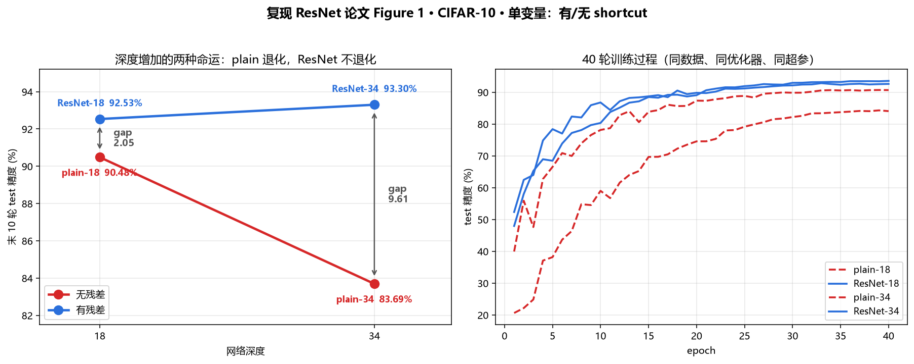
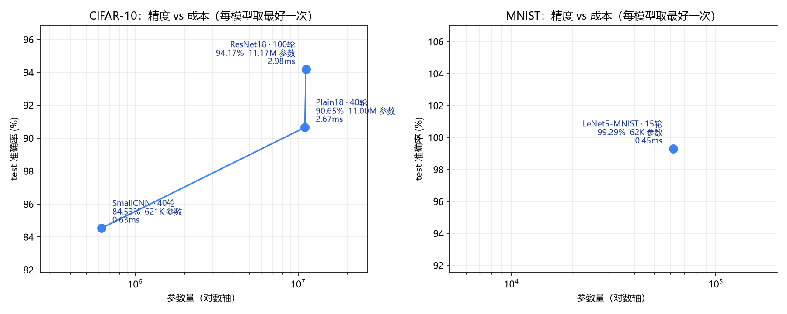

# 深度学习复现与消融研究

在单卡消费级 GPU（RTX 4060 Laptop，8 GB）上，**从零手写模型**并做**受控消融**；再把同一套方法论搬到**别人训好的模型**上，做参数高效微调。

三条主线，全部附可复现命令与实验台账：

1. **消融研究** —— 在 CIFAR-10 上复现 ResNet 论文（He et al., CVPR 2016）的**退化现象**，用三条互相独立的读数把它与「过拟合」区分开
2. **手写 Transformer 全栈** —— 单头 / 多头注意力、Pre-LN Block、位置编码、因果掩码，与 PyTorch 官方实现**逐位对齐**，并跑通 char-level mini GPT 与 ViT
3. **预训练模型微调与 LoRA** —— 在 Flowers102 上做**线性探针 / 全量微调 / 手写 LoRA** 三档对照，量化「省多少参数、付多少精度」

- 研究简报：[`research-brief.md`](research-brief.md)
- 实验台账：[`practice/EXPERIMENTS.md`](practice/EXPERIMENTS.md) · [`practice/results.csv`](practice/results.csv) · [`practice/results_flowers.csv`](practice/results_flowers.csv)
- 中文笔记（15 课）：[`practice/NOTES.md`](practice/NOTES.md)

---

## 一、核心结果 1：退化现象可以在 8 GB 笔记本上稳定复现

四个配置严格同构，唯一变量是**有没有残差连接**——同一个 `BasicBlock` 里一个 `plain` 开关控制：`plain=True` 时 `self.shortcut = None`，`forward` 直接返回 `self.relu(out)`。因此同深度两组的层数、通道、kernel 大小、BN 位置逐层一致。

40 轮，同一份 CIFAR-10（5 万训练 / 1 万测试）、同一优化器（Adam）、同一初始学习率（1e-3）、同一余弦退火、同一 batch（128）。

| 配置 | 层数 | 残差 | 参数量 | 训练集 | 测试集 | train − test |
|---|---|---|---|---|---|---|
| plain-18 | 18 | 无 | 11,000,138 | 98.91% | 90.48% | 8.43 |
| **ResNet-18** | 18 | 有 | 11,173,962 | 99.88% | **92.53%** | 7.35 |
| **plain-34** | 34 | 无 | 21,108,298 | **85.72%** | **83.69%** | 2.03 |
| **ResNet-34** | 34 | 有 | 21,282,122 | 97.63% | **93.30%** | 4.33 |

> 口径：训练集取最后一轮，测试集取最后 10 轮均值（单轮波动约 ±0.3 点）。

**加深 16 层的结果是不对称的**：无残差 −6.79 点，有残差 +0.77 点。

而残差只引入 **173,824 个参数**（+1.58%），这个数字在 18 层和 34 层**完全相同**——因为它只来自三个 stage 通道数变化处的 1×1 投影，恒等分支本身零参数。这是「结构消融而非容量消融」的硬证据。

### 三条独立证据链：为什么是「优化失败」而不是「过拟合」

同一个现象可以由不同机制产生，必须能区分。过拟合与优化失败的解法完全相反（前者加正则，后者加结构）。

| # | 观察 | 过拟合会怎么预测 | 实测 |
|---|---|---|---|
| 1 | plain-34 训练集准确率只有 **85.72%** | 过拟合的模型应该把训练集拟合到接近 100% | 训练集都没拟合上 |
| 2 | plain-34 的 train − test 只有 **2.03**，比 ResNet-34（4.33）**更小** | 过拟合的标志是 gap 大 | gap 小恰恰说明不是泛化问题 |
| 3 | 第一个 epoch 就落后 **17.9–27.4 点** | 过拟合是「练久了才开始」 | 退化从训练一开始就存在 |

第 3 条做了 seed 加固：4 个 seed 下，plain-34 首轮测试精度区间 **20.60–25.98%**，ResNet-34 为 **43.86–47.95%**，两区间**不重叠**；最不利配对仍差 **17.88 点**。所以这不是初始化运气。

同配置同种子跑两遍，实测差 **0.06 点**——这是本项目的噪声底，也是判断任何增益是否可信的尺子。



---

## 二、核心结果 2：预训练模型微调与 LoRA

同一个数据管道（Flowers102：训练 1,020 / 验证 1,020 / 测试 6,149，102 类）、同一个起点（ImageNet-21k + 1k 预训练的 ViT-B/16，85,877,094 参数）、同一 batch（32）。

**目标不是「跑通 LoRA」，而是回答：省下来的参数，究竟要付多少精度？**

| 模式 | lr | 轮 | 可训练 | 占比 | train | val | **test** | 显存 |
|---|---|---|---|---|---|---|---|---|
| scratch（从头训） | 1e-4 | 5 | 85.9M | 100% | 33.43% | 25.78% | 21.13% | 5.10 GB |
| head_only（线性探针） | 1e-3 | 15 | 78K | 0.09% | 99.61% | 85.78% | 84.11% | **0.59 GB** |
| full_ft | **1e-3** | 5 | 85.9M | 100% | 96.57% | 84.41% | **79.74%** | 5.10 GB |
| full_ft | 1e-4 | 5 | 85.9M | 100% | 100.00% | 94.80% | 91.80% | 5.10 GB |
| LoRA r=4 | 1e-3 | 5 | 447K | 0.52% | 99.80% | 91.76% | 89.02% | 3.69 GB |
| LoRA r=8 | 1e-3 | 5 | 816K | 0.94% | 99.71% | 91.86% | 89.85% | 3.70 GB |
| LoRA r=16 | 1e-3 | 5 | 1.55M | 1.78% | 99.80% | 92.16% | 89.54% | 3.71 GB |
| LoRA r=8 | 1e-3 | **15** | 816K | 0.94% | 100.00% | 94.31% | **92.57%** | 3.70 GB |
| **full_ft** | 1e-4 | **15** | 85.9M | 100% | 100.00% | **95.59%** | **94.26%** | 5.10 GB |

### 三条结论

**① LoRA 用 0.94% 的参数，差 1.69 点——而且这个差距不会消失**

```
5 轮：  full_ft 91.80  vs  LoRA 89.85  →  差 1.95 点
15 轮： full_ft 94.26  vs  LoRA 92.57  →  差 1.69 点

两个模型从 5→15 轮各涨：full_ft +2.46 点，LoRA +2.72 点
```

**涨幅几乎一样，所以差距几乎不变。** 这说明 LoRA 差的这 1.69 点是**低秩约束的容量代价**，不是训练不足。

这条判据和上面 plain-34 那个「训练集只有 85.72% → 优化失败而非过拟合」是**同一套方法**：不看到顶就断言差距来源，等于没测。

**② lr 是这张表里最大的单个因素，比 LoRA 与全量微调的差异大 7 倍**

| 同一个全量微调，只改 lr | 5 轮 test |
|---|---|
| lr = 1e-4 | **91.80%** |
| lr = 1e-3 | **79.74%** |
| 差 | **−12.06 点** |

`full_ft_lr1e3` 的第 2 轮 val 还从 57.94% 倒退到 50.39%——lr 过大时 Adam 前几步冲过头的典型特征（第一步 `m̂/√v̂ = sign(g)`，更新量恒等于 lr）。

而 LoRA 在**同一个 lr=1e-3** 下 5 轮 89.85%（单调上升、一次没倒退）、15 轮 92.57%。**它鲁棒的原因不是「参数少」，是「只动那 8 维方向」——某个参数冲过头，破坏的只是一个低秩子空间，而不是整个预训练表示。**

**③ r 不是瓶颈，轮数才是**

r 从 4 到 16 参数翻 4 倍，test 只动 **0.83 点**（测试集 6,149 张 → 1 张 = 0.016 点，0.83 点 = **51 张图**），且 val/test 排序不一致；而同一配置从 5 轮→15 轮涨 **2.72 点（170 张图）**。信号在轮数上。

### 显存账：LoRA 省的到底是什么

| | 权重 | 梯度 | AdamW m+v | 激活值 | 实测峰值 |
|---|---|---|---|---|---|
| head_only | 343 MB | 0 | 0 | **0** | **0.59 GB** |
| LoRA r=8 | 343 MB | ~3 MB | ~7 MB | 全存 | **3.70 GB** |
| full_ft | 343 MB | 343 MB | 687 MB | 全存 | **5.10 GB** |

`head_only` 只要 0.59 GB，是因为**输入与 85.9M 参数全部 `requires_grad=False` → PyTorch 根本不构建计算图、不存激活**。

LoRA 的 `lora_A/lora_B` 分散在 12 个 block 里 → 梯度要穿过整个 backbone → **激活值得全存**。所以 LoRA 与 full_ft 差的只有梯度和优化器状态那 1.03 GB。

> **只上 LoRA 省的是 27%，不是 90%。** 想真省显存得配梯度检查点或冻结更多层。

### 顺带做的一件事：手写实现 vs `peft`

`practice/lora.py` 是自己写的 309 行（`LoRALinear` + `merge/unmerge`），**5 个测试全部通过**：

| 测试 | 断言 | 实测 |
|---|---|---|
| 恒等性 | `B=0` 时输出与 base 完全相同 | **0.000e+00** |
| 对称性破缺 | 第 1 步 `∂A=0`、`∂B≠0`；第 2 步 `∂A≠0` | 0 / 2.906e-01；1.474e-02 |
| 双零死锁 | `A=B=0` 时两个梯度都为 0 | 0, 0 |
| merge 等价 | `merge()` 前后输出一致 | 2.384e-07 |
| 注入规模 | 注入后新增参数 = 手算值 | 110,592（5.78%） |

写一遍不是为了省那 340 行代码，是为了**用两条独立路径验证同一个实现**，并且真正搞懂 `target_modules` 为什么是个坑。

---

## 三、另外两组工作

### 1. 单变量消融链

SmallCNN 84.53% → ResNet-18 92.53%，逐项定位 RandomErasing **+0.45**、CIFAR 归一化 **+0.27**、CutMix **+0.32**、延长至 100 轮 **+1.50**，累积到 **95.07%**（末 10 轮均值）。

这条链的要求是**必须能加得起来**：`92.53 + 0.45 + 0.27 + 0.32 + 1.50 = 95.07`。中途曾经因为把 RandomErasing 的增益算给归一化而加不起来——为此写了 `tools/diff_config.py`，事后比对 checkpoint 的完整 config。

### 2. 手写 Transformer 全栈

不调库，逐层实现，并与 PyTorch 官方实现**逐位对齐**：

| 文件 | 内容 | 与官方最大误差 |
|---|---|---|
| `07_attention.py` | 单头自注意力 | 1.19e-07 |
| `08_mha.py` | 多头自注意力 + 掩码 | 5.96e-08 |
| `09_transformer_block.py` | 完整 Pre-LN Block（MHA + FFN + 残差 + LN） | 4.77e-07 |
| `10_pos_and_mask.py` | 正弦位置编码 + 因果掩码 | 置换等变 / 因果性实证 |
| `11_mini_gpt.py` | char-level GPT，莎士比亚语料 | val loss 1.73（均匀基线 4.17，bigram 2.48）|

`12_vit_cifar.py` 直接复用 `09` 的 Block，一行未改——Transformer Block 与模态无关。

**一组负结果**：参数匹配的 ViT 在同一数据管道下从头训练，200 轮后训练集追平 ResNet-18（98.51% vs 98.45%）但测试集差 **16.24 点**，补 CutMix 后压缩到 **10.38 点**——指向归纳偏置差异，而非训练预算不足。



---

## 四、自建评测工具

| 工具 | 作用 |
|---|---|
| `tools/model_stats.py` | 不依赖第三方库，用前向 hook 统计参数量 / MACs / CPU 推理延迟 |
| `tools/diff_config.py` | 对比两个 checkpoint 的完整 config，自动标出「实验变量」与「版本差异」，防止把两次不同条件的实验当成单变量对照 |
| `tools/fetch_weights.py` | 预训练权重断点续传：先落 `.part`、sha256 校验通过才 rename（torch 自带的会在校验失败时**把文件直接删掉**） |
| `tools/plot_depth_ablation.py` | 复现论文 Figure 1 的深度消融图 |
| `tools/demo_lowrank.py` | 低秩分解演示：为什么「训练好的 W 几乎满秩，只有 ΔW 低秩」 |
| `tools/demo_*.py` | RNG / seed 隔离演示、注意力权重可视化、CutMix λ 分布 |
| `tools/verify_*.py` | mini GPT 的四层基线校验（均匀 / unigram / bigram / 本模型）|

`diff_config.py` 是这套流程里最实用的一件：每次训练把完整配置存进 checkpoint，对比时逐项 diff。

---

## 五、复现

### 退化现象（四个配置，各约 20 分钟）

```powershell
cd practice

python .\05_resnet_train.py --epochs 40 --layers 18                --tag ablation_resnet18
python .\05_resnet_train.py --epochs 40 --layers 18 --plain        --tag ablation_plain18
python .\05_resnet_train.py --epochs 40 --layers 34                --tag p4_resnet34
python .\05_resnet_train.py --epochs 40 --layers 34 --plain        --tag p4_plain34
```

### ViT 对照（各约 62 分钟）

```powershell
python .\12_vit_cifar.py --epochs 200 --d 192 --layers 4 --heads 6 --tag vit_small_200ep
python .\12_vit_cifar.py --epochs 200 --d 192 --layers 4 --heads 6 `
    --mix cutmix --mix-alpha 1.0 --mix-prob 0.5 --tag p6_vit_cutmix_200ep
```

### 微调与 LoRA（各约 3–8 分钟，Flowers102 只有 1,020 张训练图）

```powershell
python .\13_vit_finetune.py --epochs 15 --lr 1e-3 --tag full_ft_lr1e3_15ep
python .\13_vit_finetune.py --epochs 15 --lr 1e-4 --tag full_ft_lr1e4_15ep
python .\13_vit_finetune.py --epochs 15 --head-only --lr 1e-3 --tag head_only_lr1e3_15ep
python .\14_lora_vit.py     --epochs 15 --lora-r 8 --tag lora_r8_15ep
python .\14_lora_vit.py     --epochs 15 --lora-r 4 --tag lora_r4_15ep
```

首次运行会自动下载 Flowers102（329 MB）与 ViT-B/16 权重（330 MB）。如果下载慢，见 `NOTES.md` 附录「慢下载怎么破」。

### 手写 Transformer 各组件的自检（不需要 GPU，几秒跑完）

```powershell
python .\07_attention.py          # 与 nn.MultiheadAttention(d, 1) 逐位对齐
python .\08_mha.py                # 多头对齐（含总参数量不变性验证）
python .\09_transformer_block.py  # Pre-LN / Post-LN 对比
python .\10_pos_and_mask.py       # 置换等变、位置编码、因果性
python .\11_mini_gpt.py           # 3000 步 39 秒，val 4.21 → 1.73
```

---

## 六、实验台账怎么读

| 文件 | 内容 |
|---|---|
| `practice/results.csv` | CIFAR-10 / MNIST 训练 29 条 |
| `practice/results_flowers.csv` | ViT 微调与 LoRA 10 条 |

一行一次训练：

| 列 | 含义 |
|---|---|
| `epochs / batch / lr / workers` | 训练预算与并行度 |
| `augment` | 数据增强管线，取值见 `EXPERIMENTS.md` 开头的对照表 |
| `bn / cosine / weight_decay` | 归一化、调度、正则 |
| `model` | 模型标识（ViT 带 `-w5` 后缀表示 5 轮 warmup） |
| `train_acc / test_acc` | **最后一轮**准确率（研究简报中用最后 10 轮均值） |
| `params / macs_g / infer_ms` | 参数量 / 十亿次乘加 / CPU 单张推理延迟 |

`macs_g` 统计的是 **MACs 而非 FLOPs**（1 MAC = 2 FLOPs），且只计前向。**FLOPs 不等于实测延迟**——本仓库同时记录两者，正是因为二者会给出不同的结论。

---

## 七、已知局限

主动列出，因为「知道自己的实验哪里不够硬」比数字本身重要：

- **主体实验只有 1 个 seed**（同配置复跑实测差 0.06 点）。只有首轮读数做了 4 seed 加固。
- **跨深度对比不是严格单变量**：18 层两组用 `crop+flip`，34 层两组用 `crop+flip+erase+norm+cutmix`，增强同时变了。**同深度内部的有无残差对比是干净的**；跨深度只作趋势，不作因果。
  - 反向推断：34 层增强更强、按理只会提升泛化，它仍然掉了 6.79 点，所以退化的方向性结论只会被低估。
- **只跑了 40 轮**：plain-34 的训练集准确率在 40 轮时仍在缓慢上升，没有区分「优化不动」与「优化得慢」。
- **只有 CIFAR-10**，未在 ImageNet 尺度验证。
- **ViT 对照**同时改变了预训练数据、轮数、增强、优化器与 dropout，无法把差距单独归因于归纳偏置。
- **LoRA 只落在 FFN 上，没碰 attention**。原因写在 `NOTES.md` 第 15 课：`torchvision` 的 `nn.MultiheadAttention` 里，`in_proj_weight` 是裸 Parameter（换不掉）、`out_proj` 被 fast path 直接读 `.weight` 绕过 `forward`。HF 与 timm 都没有这个障碍。
- **LoRA 每种配置只有 1 个 seed**，r=4/8/16 之间的 0.83 点差异在噪声内。
- **LoRA 只跑了 lr=1e-3**，没跑 lr=1e-4。所以「对 lr 鲁棒」只有「1e-3 下没崩」的证据。

---

## 八、环境

| 项 | 值 |
|---|---|
| GPU | NVIDIA RTX 4060 Laptop，8 GB（sm_89）|
| PyTorch | 2.14.1 + CUDA 12.6 |
| Python | 3.13.2（`.venv`）|
| 驱动 | 566.24（最高支持 CUDA 12.7，故装 cu126 而非 cu130）|

```powershell
python -m venv .venv
.\.venv\Scripts\python.exe -m pip install --index-url https://download.pytorch.org/whl/cu126 torch torchvision torchaudio
.\.venv\Scripts\python.exe -m pip install -r requirements.txt
```

数据集首次运行时自动下载到 `data/`；预训练权重缓存在 `.cache/torch`（通过 `TORCH_HOME` 指向仓库内，换机器不用重下）。

---

## 九、目录

```
.
├── research-brief.md          # 研究简报
├── practice/
│   ├── 01_baseline.py         # 可复现基线（配置抽离 + 固定 seed）
│   ├── 03_cnn_cifar.py        # SmallCNN on CIFAR-10
│   ├── resnet_model.py        # ResNet-18/34，含 --plain 消融开关
│   ├── 05_resnet_train.py     # 工程化训练脚本（argparse / checkpoint / 日志落盘）
│   ├── 06_lenet.py            # LeNet-5 on MNIST（99.29%）
│   ├── 07–11_*.py             # 手写 Transformer 全栈 + mini GPT
│   ├── 12_vit_cifar.py        # ViT on CIFAR-10（复用 09 的 Block）
│   ├── 13_vit_finetune.py     # ViT-B/16 迁移学习：scratch / head_only / full_ft
│   ├── 14_lora_vit.py         # 把 LoRA 注入 ViT，与全量微调对照
│   ├── lora.py                # 手写 LoRALinear（含 merge/unmerge + 5 个测试）
│   ├── augment_mix.py         # CutMix / MixUp（按实际挖块面积重算 λ）
│   ├── tools/                 # 参数量/MACs/延迟、config diff、各类演示脚本
│   ├── EXPERIMENTS.md         # 37 组实验的技术参数与结论
│   ├── NOTES.md               # 15 课笔记（含论文精读）
│   ├── results.csv            # CIFAR/MNIST 台账
│   └── results_flowers.csv    # 微调与 LoRA 台账
└── examples/                  # 从零学 PyTorch 的参考实现（00–04）
```

`LEARNING-PLAN.md`、`DAILY-LOG.md`、`WSL-LINUX-TRAINING.md` 是学习过程记录，与上述研究内容无关。

---

## 十、作者

潘豪 · 电子科技大学 软件工程（2024 级）
181-5058-9223 · haopan1115@gmail.com

目前在做**效率与精度之间的账**：从「18 倍参数换 9.64 点精度」的成本画像，到「0.94% 参数差 1.69 点」的 LoRA 对照。下一步是把 LoRA 落到注意力层（用自写的 `MultiHeadSelfAttention` 替换 `torch.nn.MultiheadAttention`），并接入 HuggingFace 生态用 `peft` 做一次交叉验证。同时在读图像复原方向（DnCNN / DPIR 系列）。
